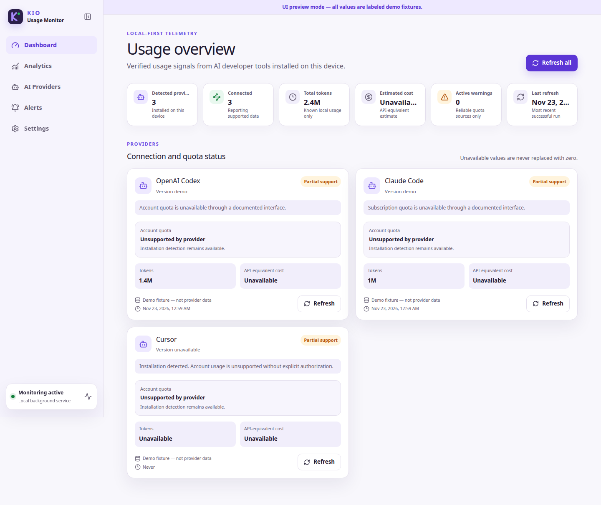

<p align="center">
  
</p>

<div align="center">

<h1>KIO Usage Monitor</h1>

<p>A local-first desktop dashboard for the usage signals of your AI coding tools. It detects the tools installed on your machine, stores normalized history in SQLite, and says "unavailable" when a provider exposes no data, instead of inventing numbers.</p>

<p align="center">
  <a href="https://github.com/toanpham2111/agentbar/actions/workflows/quality.yml"></a>
  
  
  
  
  
</p>

<p align="center">
  <strong>
    <a href="#-quickstart">Quickstart</a> · <a href="#-features">Features</a> · <a href="#-provider-support">Providers</a> · <a href="#-architecture">Architecture</a> · <a href="#-documentation">Docs</a> · <a href="docs/SECURITY.md">Security</a>
  </strong>
</p>

<p align="center">
  <a href="README.md">🇻🇳 Tiếng Việt</a> · 🇬🇧 English
</p>

<p align="center">
  
</p>

<sub>The screenshot is a UI preview: every value is labeled as a demo fixture, not provider data.</sub>

</div>

> **Status: `0.1.0` migration MVP.** The React frontend and the independently testable Rust core are implemented. Native Linux bundling needs the WebKitGTK development packages. Windows and macOS are configured for CI verification and are **not** claimed as locally verified.

---

## 📑 Table of Contents

- [Why KIO Usage Monitor?](#-why-kio-usage-monitor)
- [Features](#-features)
- [Provider support](#-provider-support)
- [Quickstart](#-quickstart)
- [Architecture](#-architecture)
- [Privacy & security](#-privacy--security)
- [Packaging & release](#-packaging--release)
- [Testing & CI](#-testing--ci)
- [Project layout](#-project-layout)
- [Documentation](#-documentation)
- [Contributing](#-contributing)
- [License](#-license)

---

## 🎯 Why KIO Usage Monitor?

Most usage dashboards show a quota number whether or not it is real. KIO takes the opposite stance:

| Typical dashboard | KIO Usage Monitor |
|---|---|
| Scrapes cookies or private OAuth endpoints to get a number | Reads only documented interfaces and safe local session logs |
| Shows `0%` when the data is missing | Shows an explicit **partial / unsupported / permission / stale / error** state |
| Needs a cloud account and sends telemetry | **No cloud backend**; everything stays on the device |
| One tool, hard-coded | Independent **adapters**, one per provider |

---

## ✨ Features

- **Tauri 2 desktop shell** with a system tray and close-to-tray behavior.
- **React + TypeScript dashboard** with system light/dark themes, charts (Recharts) and a keyboard-accessible UI.
- **Modular adapters** for Claude Code, OpenAI Codex, Gemini CLI, Cursor, GitHub Copilot and Google Antigravity.
- **Safe local-log token collection** for Claude Code and Codex.
- **Honest states**: partial, unsupported, permission, stale and error are first-class; unknown values stay `null`.
- **SQLite migrations** and a local history repository.
- **Configurable refresh**: every 1, 5, 15 or 30 minutes (Tokio scheduler).
- **Accessibility**: empty states, visible keyboard focus and reduced-motion support.

---

## 🔌 Provider support

| Provider | Detection | Local token usage | Account quota |
|---|:---:|---|---|
| OpenAI Codex | ✅ | ✅ Supported (local session logs) | Unavailable without a documented interface |
| Claude Code | ✅ | ✅ Supported (local session logs) | Unavailable without a documented interface |
| Gemini CLI | ✅ | Not yet supported | Unavailable |
| Cursor | ✅ | Not supported | Unavailable |
| GitHub Copilot | ✅ | Not supported | Needs an explicitly authorized metrics API |
| Google Antigravity | ✅ | Not supported | Unavailable |

The application **never** reads browser cookies, provider credential stores, private OAuth endpoints or private local RPC tokens. Details are in [`docs/PROVIDER_SPEC.md`](docs/PROVIDER_SPEC.md).

---

## ⚡ Quickstart

**Requirements:** Node.js 20+, Rust stable 1.90+ and the [official Tauri 2 prerequisites](https://v2.tauri.app/start/prerequisites/) for your platform.

```bash
git clone https://github.com/toanpham2111/agentbar.git
cd agentbar
npm install
npm run tauri dev
```

**Ubuntu / Debian:** install the Tauri Linux prerequisites first.

```bash
sudo apt update
sudo apt install libwebkit2gtk-4.1-dev build-essential curl wget file \
  libxdo-dev libssl-dev libayatana-appindicator3-dev librsvg2-dev
```

Frontend only (no native shell): `npm run dev`.

---

## 🏗️ Architecture

```text
React UI → typed Tauri commands → collector services → adapter registry
                                  ↘ SQLite repository
Tokio scheduler → collector → normalized snapshot → Tauri events
System tray → open / settings / refresh / quit
```

- The React frontend never receives credentials or unrestricted shell/filesystem access.
- Each adapter owns detection and collection; every quota carries its **source** and a **reliability** flag.
- The Rust core compiles separately from the desktop feature, so adapters, pricing, validation and SQLite are tested without a webview.

Full design: [`docs/ARCHITECTURE.md`](docs/ARCHITECTURE.md), [`docs/DATABASE.md`](docs/DATABASE.md).

---

## 🔒 Privacy & security

- All data stays on the device (local SQLite, no cloud backend).
- Credentials, prompts, project source code, browser cookies and authentication databases are never collected.
- Minimal Tauri capabilities (`core:default` only); no raw shell, HTTP or filesystem commands exposed to React.
- No automatic provider configuration changes and no OAuth token refresh.
- Logs and frontend payloads exclude account emails and access tokens.

See [`docs/SECURITY.md`](docs/SECURITY.md).

---

## 📦 Packaging & release

```bash
npm run tauri build
```

GitHub Actions builds native bundles on real runners: **Linux** (DEB, AppImage), **Windows** (NSIS, MSI) and **macOS** (DMG). A successful frontend build alone is not native OS verification. Signing and notarization need repository secrets owned by KIO Digital. Process: [`docs/RELEASE.md`](docs/RELEASE.md).

---

## 🧪 Testing & CI

```bash
npm run typecheck                                              # TypeScript
npm run test                                                   # Vitest
npm run test:e2e                                               # Playwright
cargo test --no-default-features --manifest-path src-tauri/Cargo.toml   # Rust core
```

CI (`.github/workflows/quality.yml`) runs typecheck, unit tests, build and E2E; Rust `fmt`, `clippy -D warnings` and tests on Ubuntu, Windows and macOS; then builds the native bundles.

---

## 🗂️ Project layout

```text
agentbar/
├── src/                 # React + TypeScript frontend (pages, components, stores)
├── src-tauri/           # Rust core: adapters, database, services, desktop shell
│   ├── src/adapters/    # claude, codex, gemini, cursor, copilot, antigravity
│   └── migrations/      # SQLite migrations
├── tests/e2e/           # Playwright tests
├── docs/                # PRD, architecture, database, provider spec, security, release
├── agentbar/            # Legacy Python app (migration reference only)
└── .github/workflows/   # Quality checks and native bundles
```

> The legacy Python **AgentBar** is kept only as a migration reference; see [`PROJECT_OVERVIEW.md`](PROJECT_OVERVIEW.md). Its private OAuth/RPC mechanisms are **not** part of KIO Usage Monitor.

---

## 📚 Documentation

| Document | Content |
|---|---|
| [Product requirements](docs/PRD.md) | Goals and scope |
| [Architecture](docs/ARCHITECTURE.md) | Components and data flow |
| [Database](docs/DATABASE.md) | SQLite schema and migrations |
| [Provider specification](docs/PROVIDER_SPEC.md) | What each adapter may read |
| [Security](docs/SECURITY.md) | Threat boundaries and controls |
| [Development](docs/DEVELOPMENT.md) | Local setup and workflow |
| [Release](docs/RELEASE.md) | Bundling, signing, verification |

---

## 🤝 Contributing

1. Keep adapters independent.
2. Preserve unknown values as `null`; never replace them with `0`.
3. Add happy-path, boundary and error tests.
4. Never add a provider integration based on an undocumented authentication bypass.

Before opening a pull request, run the commands in [Testing & CI](#-testing--ci).

---

## 📄 License

License selection is pending project-owner approval; until then, all rights are reserved by KIO Digital.
