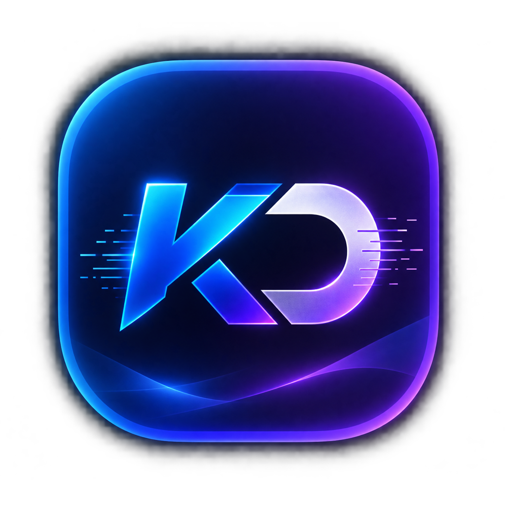
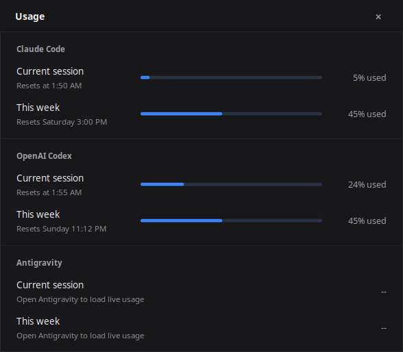

<p align="center">
  
</p>

<div align="center">

# Kio Usage Monitoring

[](https://github.com/toanpham2111/agentbar/actions/workflows/quality.yml)
[](https://github.com/toanpham2111/agentbar/releases/latest)
[](LICENSE)
[](https://www.python.org/)
[](#-installation)

**Monitor real-time quotas for Claude Code, OpenAI Codex, Google Antigravity, and Qoder directly from your desktop menu bar.**<br>
*Lightweight, local-first, zero cloud dependencies, and strictly honest telemetry.*

[🌱 Why Kio?](#-why-kio) • [🚀 Installation](#-installation) • [✨ Features](#-features) • [🔌 Supported Providers](#-supported-providers) • [⌨️ CLI & Integrations](#️-cli--integrations) • [🧪 Development](#-development) • [🔒 Privacy & Security](#-privacy--security)

</div>

---

## 🌱 Why Kio?

Modern software engineers often use multiple AI coding agents side by side. However, quota and rate-limit metrics are scattered across different dashboards, terminals, and web portals. To check remaining session tokens, weekly allowances, or reset times, developers have to interrupt their workflow and open multiple browser tabs or apps.

**Kio Usage Monitoring** consolidates verified, real-time usage metrics into a sleek desktop menu bar. Rather than adding yet another bloated web dashboard, Kio helps you answer three critical questions at a glance:

1. **Which AI coding agents are currently active on this machine?**
2. **How much session and weekly allowance has been consumed?**
3. **When does the current quota reset, or why is telemetry temporarily unavailable?**

Kio prioritizes **data integrity**: if a provider's API returns no data or a local background daemon is stopped, Kio explicitly shows `--` with the exact root cause, never synthesizing a fake `0%` or fabricated estimate.

---

## 💡 What is Kio Usage Monitoring?

Kio Usage Monitoring is a cross-platform desktop menu bar application (Linux, macOS, Windows) and CLI tool. It runs silently in the background, periodically polling local sessions and provider endpoints, normalizing usage metrics, and displaying them via native system indicators and interactive popovers.

- **Local-first architecture**: Your credentials, cookies, and tokens never leave your local device.
- **Unified telemetry**: Session windows, weekly limits, and enterprise credits rendered side-by-side with visual progress meters and reset countdowns.
- **Flexible UI modes**: Native Linux GNOME Top Panel (D-Bus / Ayatana SNI), macOS status bar, Windows system tray, and an optional floating bottom pill widget.

<p align="center">
  
</p>

<p align="center"><sub>Live capture from Kio Usage Monitoring on Linux desktop. Quota values dynamically reflect your active account status.</sub></p>

---

## ✨ Features

- **Native System Tray & Menu Bar Integration**: Minimalist indicators for Linux (GNOME/KDE/XFCE via SNI), macOS Menu Bar, and Windows Notification Area.
- **Multi-Engine Quota Tracking**:
  - **Claude Code**: Live session token window and rolling weekly rate limit.
  - **OpenAI Codex**: 5-hour rolling session window and weekly rate limits.
  - **Google Antigravity**: Real-time quota buckets read directly from the active local language server RPC.
  - **Qoder**: Enterprise Shared Add-on credit packages, usage breakdown, and renewal dates.
- **Auto-Detection**: Dynamically detects installed CLI tools and desktop apps without manual path configuration.
- **Live Watch & Status CLI**: Built-in interactive terminal dashboard (TUI), single-line summaries, and JSON streaming.
- **Status Bar Integration**: Native output formats for **Waybar**, **Polybar**, **tmux**, and **SwiftBar** / **xbar**.
- **Configurable Preferences**: Adjust refresh intervals, alert thresholds, engine visibility, and bar layout modes in the Settings GUI.
- **Low Footprint**: Consumes ~0.0% idle CPU and ~50-70 MB RAM with throttled updates and disk-caching guards.

---

## 🔌 Supported Providers

| Provider | Menu Bar Indicator | Detailed Quota View | Data Source | Notes |
|:---|:---:|:---:|:---|:---|
| **Claude Code** | ✅ | Session & Weekly limits | Local OAuth session + Anthropic usage API | Requires active Claude Code CLI session |
| **OpenAI Codex** | ✅ | 5-Hour & Weekly limits | Local session state + OpenAI usage API | Auto-detected from local configuration |
| **Google Antigravity** | ✅ | Dynamic quota buckets | Local Antigravity Language Server RPC | Active while Antigravity IDE/agent is running |
| **Qoder** | ✅ | Enterprise credits & Renewal date | Qoder Desktop local session / OpenAPI log cache | Synchronizes Enterprise package quotas |

> [!NOTE]
> Google Antigravity telemetry requires the Antigravity application or language server to be open, as its local RPC server shuts down when the app is closed.

---

## 🚀 Installation

### 🍎 macOS

Kio supports macOS (Apple Silicon M-series & Intel x86_64) via Python / Pystray or by integrating into existing menu bar managers like SwiftBar.

#### Prerequisites
- macOS 11.0 (Big Sur) or later
- Python 3.8+ (Homebrew recommended: `brew install python python-tk`)

#### Option 1: Run via Python / System Tray
```bash
# 1. Clone the repository
git clone https://github.com/toanpham2111/agentbar.git
cd agentbar

# 2. Install dependencies
pip3 install -r requirements.txt

# 3. Start Kio in menu bar mode
python3 agentbar.py bar --collapsed
```
The Kio indicator will appear in your top-right macOS menu bar. Clicking it opens the full quota details popover.

#### Option 2: Generate Standalone `AgentBar.app` Bundle
To create a standard macOS application bundle in `dist/AgentBar.app`:
```bash
python3 build_desktop_app.py
open dist/AgentBar.app
```
You can drag `AgentBar.app` into your `/Applications` folder and add it to **System Settings > General > Login Items** to run automatically at startup.

#### Option 3: Integrate with SwiftBar or xbar
If you already use [SwiftBar](https://swiftbar.app/) or [xbar](https://xbarapp.com/), you can symlink Kio directly into your plugins directory:
```bash
# Create SwiftBar 15-second refresh plugin
ln -s "$(pwd)/agentbar.py" ~/Library/Application\ Support/SwiftBar/plugins/agentbar.15s.py
```
Or view the plugin output stream directly using:
```bash
python3 agentbar.py --swiftbar
```

---

### 🪟 Windows

Kio runs seamlessly on Windows 10 and Windows 11 in the System Tray (Notification Area).

#### Prerequisites
- Windows 10 / 11 (64-bit)
- Python 3.8+ from [python.org](https://www.python.org/downloads/) (Make sure **"Add python.exe to PATH"** is checked during installation)

#### Option 1: Run via PowerShell / System Tray
```powershell
# 1. Clone the repository
git clone https://github.com/toanpham2111/agentbar.git
cd agentbar

# 2. Install required graphical and system dependencies
pip install -r requirements.txt

# 3. Launch Kio in the System Tray (bottom-right notification area)
python agentbar.py bar --collapsed
```

#### Option 2: Create Desktop & Start Menu Shortcuts
Run the packaging helper to generate Windows `.ico` assets, Desktop shortcuts, and launch scripts:
```powershell
python build_desktop_app.py
```
- A shortcut named **"Kio Usage Monitoring"** will be created on your Desktop.
- To enable automatic startup with Windows, press `Win + R`, type `shell:startup`, and copy the desktop shortcut into that folder.

---

### 🐧 Linux (Ubuntu, Debian, Fedora, Arch)

#### Ubuntu / Debian (.deb Package)
1. Download `Kio-Usage-Monitoring_1.0.0_amd64.deb` from the [GitHub Releases](https://github.com/toanpham2111/agentbar/releases/latest) page.
2. Install via GUI software manager or terminal:
   ```bash
   sudo apt install ./Kio-Usage-Monitoring_1.0.0_amd64.deb
   ```
3. Launch **Kio Usage Monitoring** from your application launcher.
4. The setup wizard will optionally configure desktop autostart on your first run.

#### Arch Linux / Fedora / Generic Linux from Source
```bash
# Clone and install dependencies
git clone https://github.com/toanpham2111/agentbar.git
cd agentbar
pip install -r requirements.txt

# Install CLI binary and desktop entry into ~/.local
python3 build_desktop_app.py

# Launch background service
agentbar start --collapsed
```

---

### 🔮 Native Standalone Installers Roadmap (Preview)

A standalone native binary compiled with **Tauri 2 + Rust** is currently in development to provide zero-dependency installers:
- **Windows**: Single-file `.exe` (NSIS) and enterprise `.msi` installers with bundled WebView2.
- **macOS**: Signed `.dmg` installers and universal `.app` bundles supporting Apple Silicon and Intel Macs.
- Technical specifications and design documents are available in [`docs/superpowers/plans/2026-11-23-native-windows-macos-installers.md`](docs/superpowers/plans/2026-11-23-native-windows-macos-installers.md).

---

## ⌨️ CLI & Integrations

The `agentbar` command line interface provides rich inspection and shell integration capabilities:

```bash
# Check current quotas in terminal
agentbar status

# Launch live TUI monitor with automatic refresh
agentbar watch

# Start daemon in background (collapsed tray pill)
agentbar start --collapsed

# Toggle visibility of the floating bottom widget
agentbar toggle-bar

# Open graphical Settings panel
agentbar settings

# Stop background monitoring daemon
agentbar stop
```

### Shell & Bar Integration Flags

| Flag | Purpose | Example Usage |
|---|---|---|
| `--short` | Compact single-line summary | `agentbar --short` |
| `--compact` | Ultra-short output for tight panels | `agentbar --compact` |
| `--waybar` | JSON payload formatted for Waybar / Polybar | Configure in `waybar/config` custom module |
| `--tmux` | Color-coded status string for tmux | `set -g status-right '#(agentbar --tmux)'` |
| `--swiftbar` | Menu bar plugin output for macOS SwiftBar / xbar | `agentbar --swiftbar` |
| `--json` | Full structured telemetry data in JSON | Automation scripts, dashboards, and CI/CD |

---

## ⚙️ Configuration

Preferences are stored locally in `~/.config/agentbar/settings.json`. You can modify settings via the GUI (`agentbar settings`) or by editing the file directly:

```json
{
  "refresh_interval_sec": 15,
  "warning_threshold_percent": 80.0,
  "bar_metric_mode": "session_primary",
  "show_floating_bar": false,
  "enabled_engines": {
    "claude": true,
    "codex": true,
    "antigravity": true,
    "qoder": true
  }
}
```

---

## 🧪 Development

### Running Tests
Kio includes full unit test suites for Python backend logic and Vitest suites for web/UI components:

```bash
# Run Python backend unit tests
python3 -m unittest discover -s tests -q

# Run frontend tests
npm test
```

### Packaging Linux Release
```bash
python3 scripts/build_linux_release.py 1.0.0
```
This builds standard `.deb` packages and checksum manifests in the `release/` directory. See [`docs/RELEASE.md`](docs/RELEASE.md) for the release checklist.

---

## 🗂️ Project Structure

```text
agentbar/
├── agentbar/              # CLI logic, telemetry detectors, menu bar backends, and SNI
│   ├── detectors.py       # Quota detection for Claude, Codex, Antigravity, Qoder
│   ├── menubar.py         # Native GTK3 and Pystray menu bar implementations
│   ├── sni_indicator.py   # D-Bus StatusNotifierItem & DBusMenu implementation
│   ├── win_mac_bar.py     # Windows & macOS tray/bottom bar backend
│   └── tui.py             # Terminal ANSI dashboard and live watch interface
├── assets/                # Application logo, icons, and provider branding
├── scripts/               # Linux release and packaging automation
├── tests/                 # Comprehensive test cases
├── docs/                  # Architecture specs, security model, and provider guides
└── .github/workflows/     # CI quality checks and release workflows
```

---

## 🔒 Privacy & Security

- **Strictly Local-First**: Authentication tokens and local RPC credentials are only accessed locally on your machine to query provider endpoints.
- **Zero Remote Telemetry**: Kio never transmits prompt contents, source code, credentials, or telemetry to external servers.
- **Verifiable Integrity**: If an agent is inactive or quota metrics are unavailable, Kio clearly reports `--` rather than guessing or interpolating numbers.

For security reports and architecture details, refer to [`docs/SECURITY.md`](docs/SECURITY.md) and [`docs/PROVIDER_SPEC.md`](docs/PROVIDER_SPEC.md).

---

## 🤝 Contributing

Contributions, bug reports, and suggestions are welcome!
Before submitting a pull request, please ensure that:
1. All unit tests pass (`python3 -m unittest discover -s tests`).
2. Code follows existing styling conventions and maintains minimal diffs.
3. Edge cases and error scenarios are covered with appropriate test fixtures.

---

## 📄 License

This project is licensed under the [MIT License](LICENSE) © 2026 KIO Digital.
