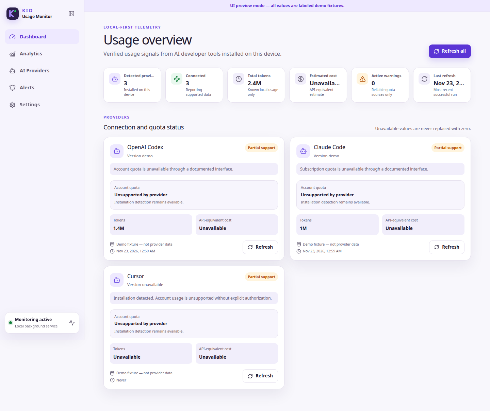

<p align="center">
  
</p>

<div align="center">

<h1>KIO Usage Monitor</h1>

<p>Bảng điều khiển desktop ưu tiên dữ liệu cục bộ, theo dõi tín hiệu sử dụng của các công cụ AI coding. Ứng dụng tự nhận diện công cụ cài trên máy, lưu lịch sử đã chuẩn hóa vào SQLite và ghi rõ "không khả dụng" khi nhà cung cấp không mở dữ liệu, thay vì tự bịa con số.</p>

<p align="center">
  <a href="https://github.com/toanpham2111/agentbar/actions/workflows/quality.yml"></a>
  
  
  
  
  
</p>

<p align="center">
  <strong>
    <a href="#-bắt-đầu-nhanh">Bắt đầu nhanh</a> · <a href="#-tính-năng">Tính năng</a> · <a href="#-nhà-cung-cấp-được-hỗ-trợ">Nhà cung cấp</a> · <a href="#️-kiến-trúc">Kiến trúc</a> · <a href="#-tài-liệu">Tài liệu</a> · <a href="docs/SECURITY.md">Bảo mật</a>
  </strong>
</p>

<p align="center">
  🇻🇳 Tiếng Việt · <a href="README.en.md">🇬🇧 English</a>
</p>

<p align="center">
  
</p>

<sub>Ảnh chụp là bản xem trước giao diện: mọi giá trị đều được gắn nhãn dữ liệu demo, không phải dữ liệu thật từ nhà cung cấp.</sub>

</div>

> **Trạng thái: bản MVP chuyển đổi `0.1.0`.** Frontend React và lõi Rust (kiểm thử độc lập) đã hoàn thành. Đóng gói native trên Linux cần các gói phát triển WebKitGTK. Windows và macOS được cấu hình để xác minh trên CI và **chưa** được khẳng định là đã kiểm tra cục bộ.

---

## 📑 Mục Lục

- [Vì sao dùng KIO Usage Monitor?](#-vì-sao-dùng-kio-usage-monitor)
- [Tính năng](#-tính-năng)
- [Nhà cung cấp được hỗ trợ](#-nhà-cung-cấp-được-hỗ-trợ)
- [Bắt đầu nhanh](#-bắt-đầu-nhanh)
- [Kiến trúc](#️-kiến-trúc)
- [Quyền riêng tư & bảo mật](#-quyền-riêng-tư--bảo-mật)
- [Đóng gói & phát hành](#-đóng-gói--phát-hành)
- [Kiểm thử & CI](#-kiểm-thử--ci)
- [Cấu trúc dự án](#️-cấu-trúc-dự-án)
- [Tài liệu](#-tài-liệu)
- [Đóng góp](#-đóng-góp)
- [Giấy phép](#-giấy-phép)

---

## 🎯 Vì sao dùng KIO Usage Monitor?

Phần lớn dashboard hiển thị một con số quota dù nó có thật hay không. KIO đi theo hướng ngược lại:

| Dashboard thông thường | KIO Usage Monitor |
|---|---|
| Lấy cookie hoặc gọi endpoint OAuth riêng tư để có con số | Chỉ đọc giao diện có tài liệu và log phiên cục bộ an toàn |
| Hiện `0%` khi thiếu dữ liệu | Hiện trạng thái rõ ràng: **một phần / không hỗ trợ / thiếu quyền / cũ / lỗi** |
| Cần tài khoản đám mây và gửi telemetry | **Không có backend đám mây**; mọi thứ nằm trên máy |
| Một công cụ, viết cứng | **Adapter** độc lập cho từng nhà cung cấp |

---

## ✨ Tính năng

- **Vỏ desktop Tauri 2** với system tray và hành vi đóng cửa sổ thì thu xuống tray.
- **Dashboard React + TypeScript** có giao diện sáng/tối theo hệ thống, biểu đồ (Recharts) và hỗ trợ bàn phím.
- **Adapter dạng module** cho Claude Code, OpenAI Codex, Gemini CLI, Cursor, GitHub Copilot và Google Antigravity.
- **Thu thập token từ log cục bộ an toàn** cho Claude Code và Codex.
- **Trạng thái trung thực**: một phần, không hỗ trợ, thiếu quyền, cũ và lỗi là các trạng thái chính thức; giá trị chưa biết giữ nguyên `null`.
- **Migration SQLite** và kho lưu lịch sử cục bộ.
- **Chu kỳ làm mới tùy chỉnh**: mỗi 1, 5, 15 hoặc 30 phút (bộ lập lịch Tokio).
- **Khả năng truy cập**: trạng thái rỗng, focus bàn phím rõ ràng và hỗ trợ giảm chuyển động.

---

## 🔌 Nhà cung cấp được hỗ trợ

| Nhà cung cấp | Nhận diện | Token dùng cục bộ | Quota tài khoản |
|---|:---:|---|---|
| OpenAI Codex | ✅ | ✅ Hỗ trợ (log phiên cục bộ) | Không khả dụng nếu chưa có giao diện có tài liệu |
| Claude Code | ✅ | ✅ Hỗ trợ (log phiên cục bộ) | Không khả dụng nếu chưa có giao diện có tài liệu |
| Gemini CLI | ✅ | Chưa hỗ trợ | Không khả dụng |
| Cursor | ✅ | Không hỗ trợ | Không khả dụng |
| GitHub Copilot | ✅ | Không hỗ trợ | Cần API metrics được cấp quyền rõ ràng |
| Google Antigravity | ✅ | Không hỗ trợ | Không khả dụng |

Ứng dụng **không bao giờ** đọc cookie trình duyệt, kho credential của nhà cung cấp, endpoint OAuth riêng tư hay token RPC cục bộ riêng tư. Chi tiết tại [`docs/PROVIDER_SPEC.md`](docs/PROVIDER_SPEC.md).

---

## ⚡ Bắt Đầu Nhanh

**Yêu cầu:** Node.js 20+, Rust stable 1.90+ và [điều kiện tiên quyết chính thức của Tauri 2](https://v2.tauri.app/start/prerequisites/) cho nền tảng của bạn.

```bash
git clone https://github.com/toanpham2111/agentbar.git
cd agentbar
npm install
npm run tauri dev
```

**Ubuntu / Debian:** cài các gói Tauri cho Linux trước.

```bash
sudo apt update
sudo apt install libwebkit2gtk-4.1-dev build-essential curl wget file \
  libxdo-dev libssl-dev libayatana-appindicator3-dev librsvg2-dev
```

Chỉ chạy frontend (không có vỏ native): `npm run dev`.

---

## 🏗️ Kiến Trúc

```text
React UI → lệnh Tauri có kiểu → collector services → adapter registry
                                  ↘ SQLite repository
Bộ lập lịch Tokio → collector → snapshot đã chuẩn hóa → sự kiện Tauri
System tray → mở / cài đặt / làm mới / thoát
```

- Frontend React không bao giờ nhận credential hay quyền shell/filesystem không giới hạn.
- Mỗi adapter tự quản lý nhận diện và thu thập; mọi quota đều kèm **nguồn** và cờ **độ tin cậy**.
- Lõi Rust biên dịch tách khỏi tính năng desktop, nên adapter, định giá, kiểm tra hợp lệ và SQLite được kiểm thử mà không cần webview.

Thiết kế đầy đủ: [`docs/ARCHITECTURE.md`](docs/ARCHITECTURE.md), [`docs/DATABASE.md`](docs/DATABASE.md).

---

## 🔒 Quyền Riêng Tư & Bảo Mật

- Toàn bộ dữ liệu nằm trên thiết bị (SQLite cục bộ, không có backend đám mây).
- Không bao giờ thu thập credential, prompt, mã nguồn dự án, cookie trình duyệt hay cơ sở dữ liệu xác thực.
- Quyền Tauri tối thiểu (chỉ `core:default`); không lộ lệnh shell, HTTP hay filesystem thô cho React.
- Không tự thay đổi cấu hình nhà cung cấp và không làm mới token OAuth.
- Log và payload gửi frontend không chứa email tài khoản hay access token.

Xem [`docs/SECURITY.md`](docs/SECURITY.md).

---

## 📦 Đóng Gói & Phát Hành

```bash
npm run tauri build
```

GitHub Actions dựng bộ cài native trên runner thật: **Linux** (DEB, AppImage), **Windows** (NSIS, MSI) và **macOS** (DMG). Build frontend thành công chưa phải là xác minh trên hệ điều hành native. Ký số và notarization cần secret của repo do KIO Digital quản lý. Quy trình: [`docs/RELEASE.md`](docs/RELEASE.md).

---

## 🧪 Kiểm Thử & CI

```bash
npm run typecheck                                              # TypeScript
npm run test                                                   # Vitest
npm run test:e2e                                               # Playwright
cargo test --no-default-features --manifest-path src-tauri/Cargo.toml   # Lõi Rust
```

CI (`.github/workflows/quality.yml`) chạy typecheck, unit test, build và E2E; Rust `fmt`, `clippy -D warnings` và test trên Ubuntu, Windows, macOS; sau đó dựng các bộ cài native.

---

## 🗂️ Cấu Trúc Dự Án

```text
agentbar/
├── src/                 # Frontend React + TypeScript (pages, components, stores)
├── src-tauri/           # Lõi Rust: adapters, database, services, vỏ desktop
│   ├── src/adapters/    # claude, codex, gemini, cursor, copilot, antigravity
│   └── migrations/      # Migration SQLite
├── tests/e2e/           # Kiểm thử Playwright
├── docs/                # PRD, kiến trúc, database, đặc tả provider, bảo mật, phát hành
├── agentbar/            # Ứng dụng Python cũ (chỉ để tham chiếu khi chuyển đổi)
└── .github/workflows/   # Kiểm tra chất lượng và bộ cài native
```

> **AgentBar** bản Python cũ chỉ được giữ làm tham chiếu chuyển đổi; xem [`PROJECT_OVERVIEW.md`](PROJECT_OVERVIEW.md). Các cơ chế OAuth/RPC riêng tư của bản cũ **không** thuộc KIO Usage Monitor.

---

## 📚 Tài Liệu

| Tài liệu | Nội dung |
|---|---|
| [Yêu cầu sản phẩm](docs/PRD.md) | Mục tiêu và phạm vi |
| [Kiến trúc](docs/ARCHITECTURE.md) | Thành phần và luồng dữ liệu |
| [Database](docs/DATABASE.md) | Schema SQLite và migration |
| [Đặc tả provider](docs/PROVIDER_SPEC.md) | Mỗi adapter được phép đọc gì |
| [Bảo mật](docs/SECURITY.md) | Ranh giới đe dọa và biện pháp kiểm soát |
| [Phát triển](docs/DEVELOPMENT.md) | Cài đặt cục bộ và quy trình làm việc |
| [Phát hành](docs/RELEASE.md) | Đóng gói, ký số, xác minh |

---

## 🤝 Đóng Góp

1. Giữ các adapter độc lập với nhau.
2. Giữ giá trị chưa biết là `null`; không thay bằng `0`.
3. Thêm test cho luồng chính, biên và lỗi.
4. Không thêm tích hợp nhà cung cấp dựa trên cách vượt xác thực không có tài liệu.

Trước khi mở pull request, hãy chạy các lệnh trong mục [Kiểm thử & CI](#-kiểm-thử--ci).

---

## 📄 Giấy Phép

Giấy phép đang chờ chủ dự án phê duyệt; trong thời gian đó, mọi quyền được bảo lưu bởi KIO Digital.
